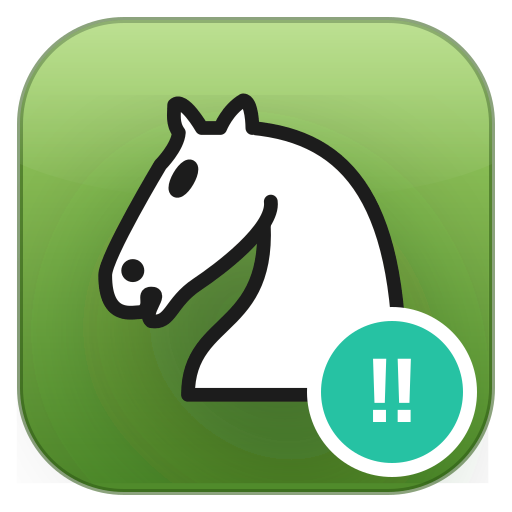
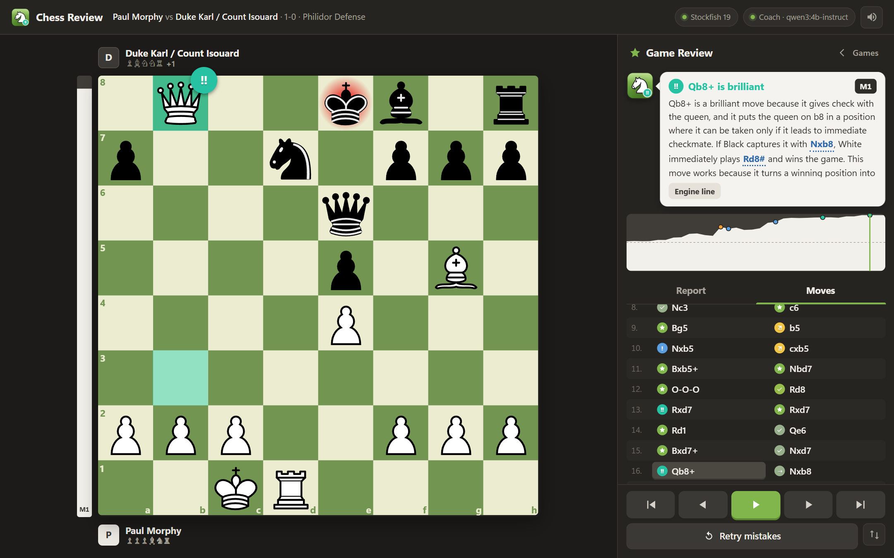
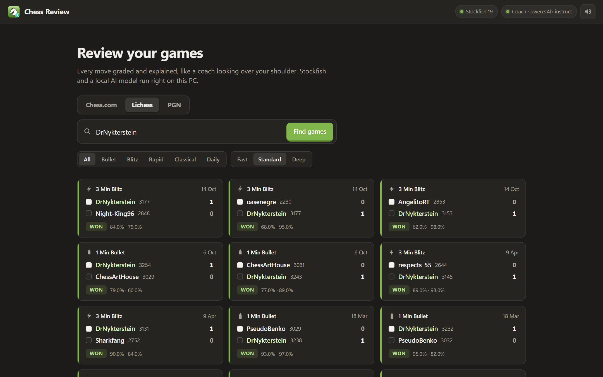
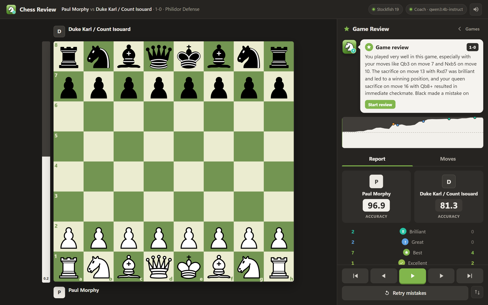
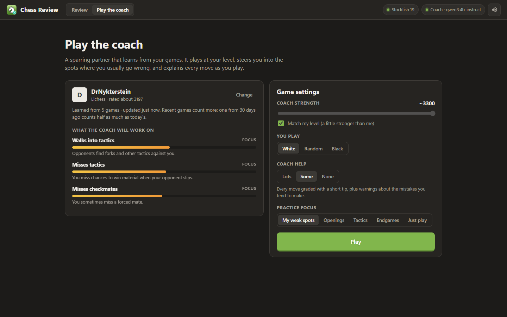
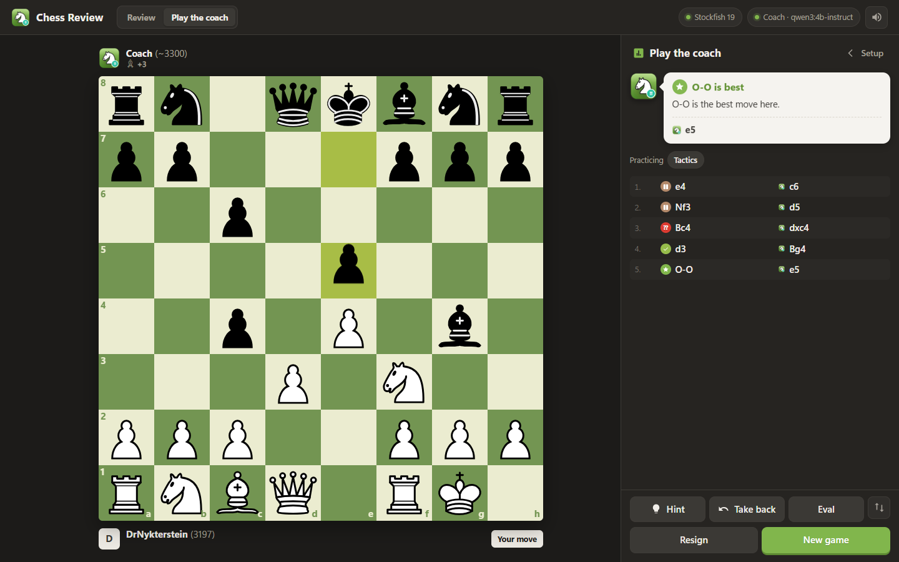

<div align="center">



# Chess Review

**Chess.com-style game review that runs entirely on your own PC.**
Stockfish grades every move, and a local AI coach explains them in plain English.

[](https://github.com/PriyanshKuniyal/chess-review/releases/latest)
[](https://github.com/PriyanshKuniyal/chess-review/actions/workflows/ci.yml)
[](LICENSE)



</div>

## Features

- **Every move classified**: Brilliant, Great, Best, Excellent, Good, Book, Inaccuracy, Mistake,
  Miss, Blunder and Forced, with the badge on the board and the move squares tinted like on Chess.com.
- **A coach that explains why**: a small local language model writes 2–3 sentences for each move
  and a summary of the game. The engine and board code work out the reason first (a fork, a
  hanging piece, a missed mate, material lost), so the model only puts it into words.
  Key ideas in the text ("loses a knight", "checkmate", moves it mentions) are clickable and play
  out the line behind them on the board.
- **Your games from anywhere**: enter a **Chess.com** or **Lichess** username, or paste or drop a
  **PGN** file.
- **Game report**: accuracy for both players, an estimated game rating, accuracy per phase
  (opening, middlegame, endgame) and a count of each move type.
- **Retry mistakes**: replay your inaccuracies, mistakes and blunders as puzzles, with hints.
- **Play the coach**: a sparring partner that learns your weak spots from your recent games and
  plays to train them, explaining every move as you go ([details](#play-the-coach)).
- **Puzzles from your own mistakes**: every position where you went wrong in your recent games
  becomes a puzzle, with spaced repetition so they stick ([details](#puzzles-from-your-own-mistakes)).
- **Analysis board**: drag any piece to try your own ideas. Each move you play is graded and
  explained, a blue arrow shows the engine's best reply so you can keep going, and "Show best" /
  "Engine line" play the engine's lines so you can step through them.
- **Feels like the real thing**: animated pieces, wooden move and capture sounds, an animated
  eval bar that flashes on big moments, a clickable eval graph, best-move arrows (L-shaped for
  knights), "Show best", autoplay and keyboard shortcuts.
- **Private and free**: no account and no cloud. The only network calls fetch your public games
  from Chess.com or Lichess.

<table>
  <tr>
    <td></td>
    <td></td>
  </tr>
  <tr>
    <td align="center">Pick a game from Chess.com, Lichess or a PGN</td>
    <td align="center">The game report and coach summary</td>
  </tr>
</table>

## Install (Windows)

1. Download **`Chess-Review-vX.Y.Z-windows-x64.zip`** from the
   [latest release](https://github.com/PriyanshKuniyal/chess-review/releases/latest).
2. Unzip it anywhere, for example into `Documents`.
3. Double-click **`Chess Review.exe`**. Right-click it and choose *Send to → Desktop (create
   shortcut)* if you want a desktop icon.

The zip includes Stockfish and Node.js, so nothing else needs installing. The app opens in its
own window, and everything shuts down about 20 seconds after you close it.

> **Windows SmartScreen** may warn that the app is from an unknown publisher, because the
> launcher isn't code-signed. Click *More info → Run anyway*. The launcher's source is in
> [`launcher/Launcher.cs`](launcher/Launcher.cs) if you'd like to check it.

### Turn on the AI coach (optional, recommended)

Reviews work without it. The move labels then come with short built-in descriptions instead
of written explanations.

1. Install [Ollama](https://ollama.com/download) (free) and make sure it's running.
2. In Chess Review, click **Set up coach** (top right) and then **Download model**. That
   fetches `qwen3:4b-instruct` once (about 2.5 GB).

On a GPU with 4 GB of VRAM or more, explanations take under a second. CPU-only works too, just
slower.

## Run from source (Windows, macOS, Linux)

You need [Node.js](https://nodejs.org/) 20 or newer, and optionally [Ollama](https://ollama.com/download).

```bash
git clone https://github.com/PriyanshKuniyal/chess-review.git
cd chess-review
npm install
npm run setup     # downloads Stockfish for your OS into ./engine and checks Ollama
npm start         # then open http://localhost:3000
```

To use a Stockfish you already have, set `STOCKFISH_PATH` (or put `stockfish` on your PATH)
instead of running `npm run setup`.

To build the Windows launcher (`Chess Review.exe`) from source, run `npm run build:launcher`. It
uses the C# compiler that ships with Windows.

## Using it

| Action | How |
| --- | --- |
| Step through moves | <kbd>←</kbd> <kbd>→</kbd>, or click a move or the eval graph |
| Jump to start / end | <kbd>Home</kbd> / <kbd>End</kbd> |
| Autoplay | <kbd>Space</kbd> or the green play button |
| Flip the board | <kbd>F</kbd> |
| Sound on/off | <kbd>M</kbd> or the speaker button |
| Try your own move | Drag a piece; your line shows up under the game move |
| See the engine's line | **Show best** (or **Engine line** on good moves), then <kbd>→</kbd> to step through it |
| Back to the game | <kbd>Esc</kbd>, **Back to game**, or ✕ on the variation |
| See an idea play out | Click a highlighted phrase or move in the coach's explanation |
| Promote a pawn | Move it to the last rank and pick the piece |
| Practice your mistakes | **Retry mistakes** |

**Analysis depth**: *Fast* (14) takes a few seconds, *Standard* (18) is the default, and *Deep*
(22) is slower but more precise. Reviews are cached in `cache/`, so reopening a game is instant.

## Play the coach

Switch to **Play the coach** in the top bar for a practice game against a coach that adapts to you.

<table>
  <tr>
    <td></td>
    <td></td>
  </tr>
</table>

**It learns from your games.** Enter your Chess.com or Lichess username (searching your games in
Review does this too) and the coach analyses your recent games in the background, up to 60 from the
last 6 months, a few seconds each. It works out:

- your weak spots, from your actual mistakes: leaving pieces undefended, walking into tactics,
  missing tactics, missing or overlooking mates, and whether your errors cluster in the opening,
  middlegame or endgame,
- the openings that cost you points (by color),
- your playing strength.

Recent games count more: a game from 30 days ago weighs half as much as today's, one from 60 days a
quarter. Everything is saved on your PC (`%APPDATA%\ChessReview\profiles` on Windows), and each time
the app starts it only analyses games played since last time.

**It plays to train you.** The coach plays a little above your level and, depending on your weak
spots (or the focus you pick):

- steers into **openings** you've been losing in, following the line from your own games,
- sets up **tactics** for you to find (verified by Stockfish) and tells you there's one to look for,
- puts **pressure** on loose pieces if you tend to leave them hanging, and warns you about threats,
- **trades down** into endgames if that's where you go wrong.

**It explains as you play.** Every move you make is graded (Best, Mistake, Blunder…) with a short
explanation and clickable ideas, plus a note when it's a pattern from your games. Hints come in three
steps (the coach's threat, which piece to move, the move), you can take moves back, and the game ends
with a summary. **Review this game** opens the full review. Coach help can be set to Lots, Some or None.

## Puzzles from your own mistakes

The **Puzzles** tab turns the positions where you made a mistake, blunder or miss in your recent
games (from the same profile the coach learns) into puzzles: find a better move than the one you
played. They're themed by what went wrong (find the tactic, spot the danger, keep your pieces safe,
stop the mate, find the checkmate), and any move about as good as Stockfish's best counts.

After each one the coach explains why the right move works and why your game move didn't, with
clickable lines. Puzzles you solve on the first try come back after 1, 3, 7, 14 and 30 days; ones
you miss come back the same day. Recent games and your biggest weak spots come first.

## How moves are classified

Each position is analyzed by Stockfish, and the evaluation is turned into a win probability
(the same curve Lichess uses). A move's **loss** is how much win probability it gives away
compared with the best move:

| Label | Rule |
| --- | --- |
| **Best** | The engine's top move, or equal to it |
| **Excellent / Good** | Loses under 2% / under 5% |
| **Inaccuracy / Mistake / Blunder** | Loses under 10% / under 20% / 20% or more |
| **Book** | Still in the opening database (from the start of the game) |
| **Brilliant** | A near-best move that really sacrifices material (a piece is left hanging) and keeps a good position |
| **Great** | The only good move: every alternative is at least 18% worse. Obvious recaptures don't count |
| **Miss** | An inaccuracy or worse right after the opponent erred (or one that skips a forced mate) |
| **Forced** | The only legal move |

**Accuracy** uses the Lichess formula, a mix of a volatility-weighted mean and a harmonic mean
of per-move accuracy. **Game rating** is a rough estimate from accuracy, pulled toward the
player's actual rating. Like Chess.com's, it's just for fun.

## Configuration

All optional, set as environment variables:

| Variable | Default | What it does |
| --- | --- | --- |
| `PORT` | `3000` | Port for the local server |
| `STOCKFISH_PATH` | auto | Path to a Stockfish executable |
| `COACH_MODEL` | `qwen3:4b-instruct` | Any Ollama chat model, e.g. `qwen3:8b` for better writing |
| `OLLAMA_HOST` | `http://127.0.0.1:11434` | Where Ollama is running |
| `CHESS_REVIEW_NO_UPDATE_CHECK` | unset | Set to `1` to skip the check for new releases |
| `CHESS_REVIEW_DATA` | `%APPDATA%\ChessReview` | Where player profiles are stored |
| `CHESS_REVIEW_PROFILE_GAMES` | `60` | How many recent games the coach learns from |

## Troubleshooting

- **The app doesn't open**: look at `server.log` in the app folder; it says what went wrong.
  The usual cause is something else using port 3000.
- **"Set up coach" won't go away**: make sure Ollama is running (its icon is in the system
  tray), then click **Check again**.
- **Explanations are slow**: the model is probably running on the CPU. Try a smaller model,
  e.g. `COACH_MODEL=qwen3:1.7b`.
- **Lichess says "rate limiting"**: wait a minute; Lichess limits how fast games can be downloaded.

## Project structure

```text
server.js              Local HTTP server and API
lib/analysis.js        Classification, accuracy, rating, coach facts
lib/tactics.js         Forks, hanging pieces, sacrifices, material along engine lines
lib/engine.js          Stockfish UCI wrapper and engine pool
lib/coach.js           Ollama prompts and model download
lib/chesscom.js        Chess.com public API
lib/lichess.js         Lichess public API
lib/profile.js         Player profiles: background learning, weak spots, time weighting
lib/coachplay.js       The coach as an opponent: strength and practice steering
public/                The web UI: app.js (review), play.js (play the coach), puzzles.js, shared.js, sounds
launcher/              Windows launcher (C#) with splash screen
scripts/               Setup, smoke test, screenshots, release notes
data/                  Opening book (lichess-org/chess-openings, CC0)
```

## Releasing

1. Update `version` in `package.json` and add a section to [`CHANGELOG.md`](CHANGELOG.md).
2. Commit, then tag and push: `git tag v1.2.0 && git push origin main v1.2.0`.
3. The [release workflow](.github/workflows/release.yml) builds the Windows zip (Stockfish,
   Node.js and the launcher included) and publishes the GitHub Release with notes from the changelog.

Running copies of the app show an "Update available" badge once a newer release is out.

## Contributing

Issues and pull requests are welcome. Before opening a PR, run `npm test` (a quick end-to-end
review of Morphy's Opera Game). If you change the UI, `npm run screenshots` regenerates the
images in this README while the app is running.

## License and credits

Chess Review is free software under the [GNU GPL v3 or later](LICENSE). It builds on
[Stockfish](https://stockfishchess.org/), [chessground](https://github.com/lichess-org/chessground),
[chess.js](https://github.com/jhlywa/chess.js), the
[lichess opening database](https://github.com/lichess-org/chess-openings),
[Kenney's](https://kenney.nl) CC0 sounds and [Ollama](https://ollama.com). See
[THIRD_PARTY_NOTICES.md](THIRD_PARTY_NOTICES.md) for details.

Chess Review is not affiliated with Chess.com or Lichess.
